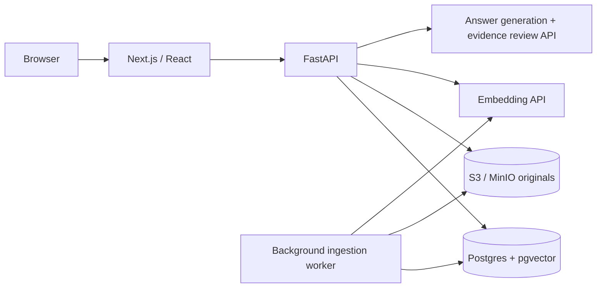

# Sourceboard — Production RAG Knowledge Base SaaS

FastAPI + Next.js + Postgres/pgvector + a durable background worker + S3-compatible object storage + a configurable model API.

The application uploads company documents, indexes their passages in the background, retrieves semantic matches, and generates answers with inspectable citations. Missing evidence, invalid citations, and unsupported model claims produce explicit abstentions. Provider outages produce a service error instead of a fabricated answer.

## Start with Docker

Requires Docker Engine/Desktop with Compose v2.

```powershell
Copy-Item .env.example .env
# Edit .env and set MODEL_API_KEY to your provider key.
docker compose up --build
```

Open **http://localhost:3000** and create a workspace. API documentation: **http://localhost:8000/docs**. MinIO console: **http://localhost:9001**. The example credentials are for local development only. Ports bind to localhost.

The migration container applies versioned SQL migrations and creates the private object bucket before API and worker startup. Data persists in named Postgres and MinIO volumes. The app can start without a model key, but uploads are disabled with a clear configuration message.

## Architecture



| Layer | Implementation |
| --- | --- |
| Frontend | Next.js App Router, React, TypeScript; same-origin API proxy |
| API | Python/FastAPI with typed inputs, session authentication, tenant-scoped queries |
| Database | Postgres 17 with pgvector, versioned SQL migrations |
| Queue | Postgres document jobs, `FOR UPDATE SKIP LOCKED`, worker leases and retry state |
| Worker | Separate Python process; extraction, page-aware chunking, batched embeddings, atomic publication |
| Storage | Private S3-compatible bucket; MinIO in local Compose |
| Models | OpenAI-compatible embeddings and Chat Completions endpoints with strict JSON schemas |
| Containers | Separate web, API, worker, migration, Postgres, and MinIO services |

LangGraph and LlamaIndex are intentionally optional and are not dependencies. The retrieval pipeline is explicit in `backend/app/rag.py`; orchestration can be introduced when branching or multi-step workflows justify it. Qdrant is not used because this implementation selects pgvector.

## Ingestion and retrieval

1. The API validates file type and size, stores the original under a workspace-specific object key, and commits a queued document row. Failed database writes attempt compensating object deletion.
2. A worker claims the job with a lease, extracts PDF/TXT/Markdown/CSV text, and creates overlapping passages with physical PDF page numbers. Scans need external OCR. Limits: 10 MB, 300 PDF pages, 2 million extracted characters.
3. The worker embeds passages in batches. Chunk vectors and ready status publish in one transaction. Failed transient jobs retry up to three attempts; failed documents have a Retry action. Expired worker leases are recoverable. Fencing tokens prevent stale workers publishing after deletion or a later claim.
4. A question is embedded and compared with vectors belonging to that workspace and the configured embedding model. The initial implementation uses exact cosine search over tenant-filtered candidates. An HNSW index is intentionally deferred until tenant recall and scale are measured.
5. The model produces structured claims and verbatim quotes. The server rejects unknown source IDs, absent citations, malformed responses, and quotes that do not exist in the retrieved passages. A second model pass checks whether the claims are supported by the quotes.
6. The API rechecks source availability before saving history. Deletion immediately removes chunks from search, purges workspace history, and queues original-object cleanup. The frontend shows deletion until storage cleanup succeeds.

The embedding schema is **1536 dimensions**. The example uses `text-embedding-3-small` and `gpt-4.1-mini`; both are configurable and require provider access. Compatible providers must support the embeddings `dimensions` parameter and Chat Completions `json_schema` response format. Changing dimensions requires a schema migration and reindex. Changing the embedding model excludes old vectors from retrieval; delete/re-upload affected documents to reindex.

`MIN_SIMILARITY=0.40` is an initial retrieval threshold, not a confidence score. Tune it on representative company questions. Citation integrity and a model review reduce failure modes but do not guarantee factual entailment, completeness, recency, or resistance to every prompt injection. Review the evidence and add an evaluated groundedness dataset before client deployment.

**Data flow:** originals are stored in your bucket; document passages go to the embedding provider; questions, retrieved excerpts, and draft claims go to the configured model provider. Provider keys remain server-side. This is not an entirely local AI system.

## Local development

### Gemini configuration

Create a key in [Google AI Studio](https://aistudio.google.com/apikey), then set these values in the root `.env`:

```dotenv
MODEL_API_KEY=your-google-ai-studio-key
MODEL_BASE_URL=https://generativelanguage.googleapis.com/v1beta/openai
EMBEDDING_MODEL=gemini-embedding-2
CHAT_MODEL=gemini-3.5-flash-lite
```

Apply changes with `docker compose up --build -d`. Gemini uses Google's [OpenAI-compatible API](https://ai.google.dev/gemini-api/docs/openai). The provider handles Google's omitted zero embedding index while still validating batch ordering and 1536-dimensional vectors. These models offer [free tiers](https://ai.google.dev/gemini-api/docs/pricing), subject to account quotas; free-tier content may be used to improve Google's products. Existing documents embedded with another model must be deleted and uploaded again to appear in retrieval.

Python 3.12 is the container target; local validation also supports Python 3.14. Node 22 is the frontend container target.

```powershell
python -m venv .venv
.\.venv\Scripts\python -m pip install -r requirements.txt
Copy-Item .env.example .env
# Set MODEL_API_KEY in .env.
docker compose up -d postgres minio
.\.venv\Scripts\python -m backend.app.migrate
.\.venv\Scripts\python -m uvicorn backend.app.main:app --reload --port 8000
```

In separate terminals, from the repository root:

```powershell
.\.venv\Scripts\python -m backend.app.worker
```

```powershell
npm --prefix frontend ci
npm --prefix frontend run dev
```

Use **http://localhost:3000**, matching `APP_ORIGIN`. If using a different origin, update that setting. `API_INTERNAL_URL` is a server-only Next.js setting; it defaults to `http://127.0.0.1:8000` locally and is `http://api:8000` in Docker. Configure it in `frontend/.env.local` when needed. Python settings read the root `.env` when commands run from the root.

## Tests

```powershell
.\.venv\Scripts\python -m pytest -c backend/pytest.ini backend/tests -q
npm --prefix frontend run build
```

Unit/API tests cover unauthenticated access, CSRF checks, input limits, chunk boundaries, embedding validation, missing provider credentials, refusal/truncation, invented citations, invented quotes, and rejected unsupported claims. They do not call paid model APIs.

Run the full integration suite with isolated, disposable Postgres/MinIO services and deterministic fake model responses:

```powershell
docker compose -f compose.test.yaml up --build --abort-on-container-exit --exit-code-from tests
docker compose -f compose.test.yaml down
```

This exercises registration, real multipart upload, real object storage, worker execution, pgvector retrieval, tenant isolation, history cleanup, object deletion, and stale-worker fencing. The test stack uses separate infrastructure and no application data volumes. Tests skip integration cases unless `TEST_DATABASE_URL` is explicitly supplied. Never point that variable at production.

Dependency versions tested locally are captured in `backend/constraints.txt` and `frontend/package-lock.json`. Container Linux-only dependencies are resolved during the Docker build.

## Deployment limits

This is a working implementation of the requested architecture, not a claim of production certification. Accounts currently have one private workspace each; shared memberships, invitations, and roles remain to be implemented. Before exposing it publicly, add an identity provider or email verification/password recovery, distributed rate limits and spend quotas, malware scanning and stronger parser isolation, TLS with `COOKIE_SECURE=true`, secret management, object lifecycle reconciliation, backups/restore drills, audit logs, metrics, and retrieval/groundedness evaluations. S3/database writes are not a distributed transaction: a process crash between object creation and row commit can leave an orphan, so production storage needs reconciliation. Provider cancellation does not roll back completed API usage.

PDF parsing runs in the separate worker with a Compose memory/CPU limit, but there is no per-file sandbox or hard parsing deadline yet. The worker is not a full general-purpose task platform. Use immutable container image digests and a reviewed deployment configuration for production. MinIO uses its administrative development credentials locally; use a scoped bucket identity in production. Do not publish the database, object console, or development defaults.

The original SQLite/extractive prototype is archived under `legacy/` for reference. Its accounts and documents are not automatically migrated to Postgres; re-register and re-upload documents. `server.py` now starts the FastAPI service for compatibility. The active application is `backend/` + `frontend/`.

## Implementation references

- [FastAPI container deployment](https://fastapi.tiangolo.com/deployment/docker/)
- [Next.js App Router installation](https://nextjs.org/docs/app/getting-started/installation)
- [pgvector](https://github.com/pgvector/pgvector)
- [OpenAI embeddings](https://developers.openai.com/api/docs/guides/embeddings)
- [OpenAI structured outputs](https://developers.openai.com/api/docs/guides/structured-outputs)
